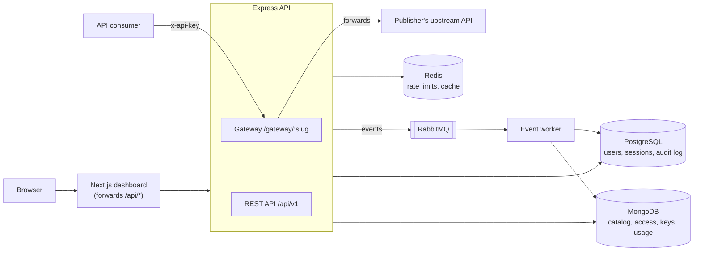

# API Management System

[](https://github.com/PSB21/enterprise-nodejs-api-platform/actions/workflows/ci.yml)

A platform for sharing APIs safely. Publishers list their APIs with usage plans, developers request access and receive API keys, and a gateway checks every call, enforces each plan's limits and records usage for analytics.

**Stack:** TypeScript · Node.js · Express · MongoDB · PostgreSQL · Redis · RabbitMQ · Next.js · React · Redux Toolkit · React Query · Tailwind CSS · Jest · Docker

## What each role can do

| Role          | In the dashboard                                                                                                   |
| ------------- | ------------------------------------------------------------------------------------------------------------------ |
| **Developer** | Browse and search the API catalog, request access in three steps, create and revoke API keys, see own usage        |
| **Publisher** | Everything above for browsing, plus a review queue to approve, reject or revoke access, and analytics for own APIs |
| **Admin**     | Review any request, see any API's analytics, change user roles, read the audit log                                 |

## Architecture



- **PostgreSQL** (Prisma) holds accounts, refresh-token sessions and the audit log: fixed structure, enforced constraints.
- **MongoDB** (Mongoose) holds the API catalog with embedded plans, access requests, API keys, notifications and usage logs: flexible documents, transactions and aggregation.
- **Redis** is optional: without it, rate limits and caches are kept in memory.
- **RabbitMQ** is optional: without it, events are handled inside the API.

The reasons behind these choices, and their trade-offs, are in [docs/DECISIONS.md](docs/DECISIONS.md).

## Highlights

- **Auth:** bcrypt password hashing, 15-minute JWT access tokens, rotating refresh tokens in an httpOnly cookie with reuse detection, role-based access control, and login throttling.
- **Access workflow:** approving or revoking access and notifying the developer happen in one MongoDB transaction. A partial unique index allows one active request per developer and API.
- **API keys:** shown once, stored only as SHA-256 hashes, and revocable. Revocation reaches the gateway immediately, despite caching.
- **Gateway:** per-plan rate limits and monthly quotas, an upstream host allowlist against SSRF, path-traversal checks, timeouts, and a header allowlist so caller secrets are never forwarded.
- **Analytics:** aggregation pipelines for request counts, error rates, average and p95 latency, and hourly or daily time series.
- **Events:** published after each change; the worker writes the audit log and notifications idempotently, retries once and then dead-letters.
- **Documentation:** the OpenAPI document is generated from the same Zod schemas that validate requests, and a test fails if any route is undocumented.

## Run it

You need Node.js 24 (see [.nvmrc](.nvmrc)) and free [Neon](https://neon.tech) and [MongoDB Atlas](https://www.mongodb.com/cloud/atlas) databases.

```bash
npm install
cp apps/api/.env.example apps/api/.env   # fill in the database URLs and JWT_SECRET
npm run db:deploy --workspace=@ams/api   # create the Postgres tables
npm run db:seed --workspace=@ams/api     # demo users, APIs and a week of synthetic traffic
npm run dev                              # API:       http://localhost:5000
npm run dev:web                          # dashboard: http://localhost:3000
```

Demo accounts (password `DemoPass123!`): `developer@ams.dev`, `publisher@ams.dev`, `admin@ams.dev`.

API documentation (Swagger UI) is at http://localhost:5000/api/docs.

To run everything in containers instead, or to deploy a free public demo, see [docs/DEPLOYMENT.md](docs/DEPLOYMENT.md).

## Tests

```bash
npm test          # API and dashboard
npm run lint
npm run typecheck
```

- **API (Jest, Supertest):** integration tests against real databases: a separate Neon branch and Atlas database locally, or Postgres and an in-memory MongoDB replica set in CI. CI also runs the rate limiter and event tests against real Redis and RabbitMQ.
- **Dashboard (Jest, React Testing Library):** components such as the login form, the access request wizard and the one-time key display, plus the token refresh logic.
- **CI (GitHub Actions):** lint, types, tests and builds for both apps, then builds the Docker images and starts the full stack.

## Project structure

```
apps/
  api/                 Express API, gateway and event worker
    prisma/            Postgres schema and migrations
    src/modules/       One folder per feature: routes, schemas, service, docs
    src/events/        Event bus, RabbitMQ topology and handlers
    tests/             Integration tests
  web/                 Next.js dashboard
    src/app/           Pages (App Router)
    src/components/    UI components and their tests
    src/lib/           API client, React Query hooks
    src/store/         Redux Toolkit slices
docs/                  Decisions, deployment guide, benchmark
docker-compose.yml     The whole system in containers
```

## Performance

Caching gateway lookups raised throughput from 27 to 758 requests per second in a laptop test against cloud databases. The setup and the reasons the gain is this large are in [docs/benchmarks.md](docs/benchmarks.md).
